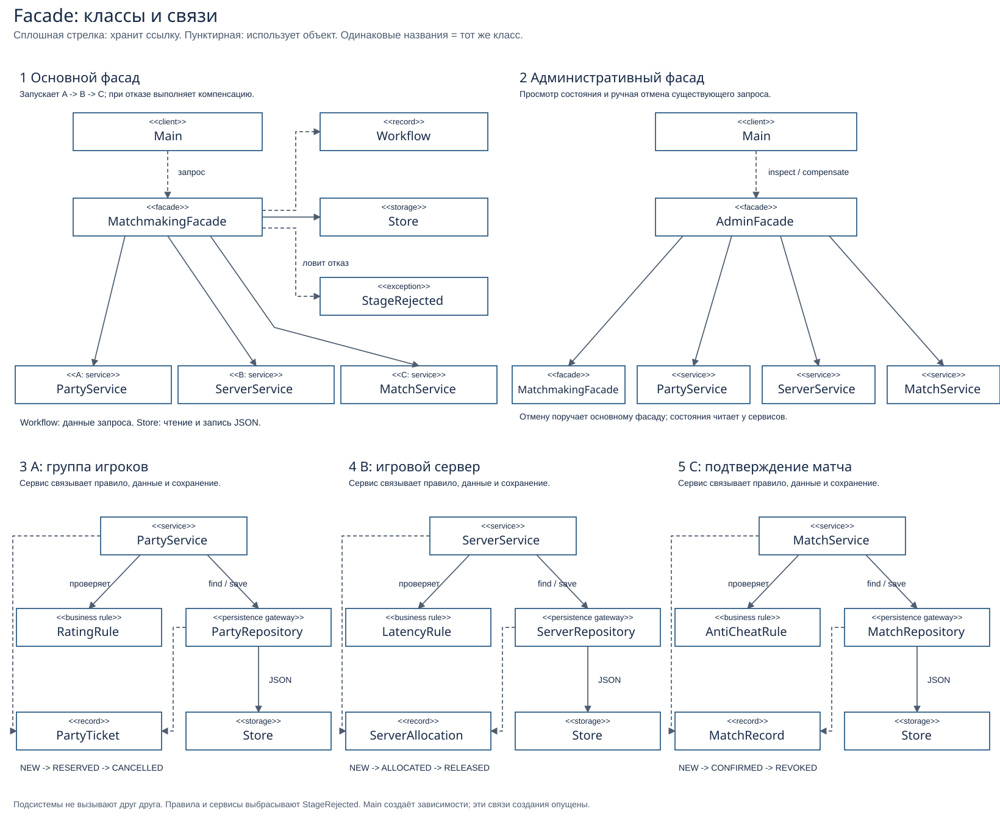

# Assignment 4 - Matchmaking Facade

Variant 16: **Video Game Matchmaking**. A working Java console application coordinates party reservation (A), server allocation (B), and anti-cheat confirmation with a saved match record (C). The three subsystems are independent. Their state and the chain's progress are stored in JSON and survive an application restart.

## UML class diagram

[Open the complete UML diagram](docs/class-diagram.svg). All 18 project classes are shown; repeated names represent the same class.



Solid arrows show stored references; dashed arrows show object use. Read the two facade panels first, then subsystems A, B and C below. Main constructs the dependencies; constructor wiring is omitted for clarity. Rules and services throw `StageRejected`; MatchmakingFacade catches B/C rejection and compensates completed steps.

## Build and run

Requirements: Java 17+ and Maven 3.9+. The first build downloads dependencies.

```powershell
.\run.cmd
```

This single command builds and launches the application. The executable JAR includes Gson. To choose a separate data directory after building:

```powershell
java -jar target/matchmaking-facade-1.0.0.jar demo-data
```

The default directory is `data` in the current working directory. Restart with the same directory to read earlier requests.

## Menu and defense demonstration

| Option | Action |
|---|---|
| 1 | Enter a new request; choose a full run or stop after A |
| 2 | Perform the next saved step for a request ID |
| 3 | Inspect persisted states for a request ID |
| 4 | Manually compensate a request ID |
| 0 | Exit |

Use option 1 and answer **yes** to `Run all steps now?` for these full-run scenarios:

| Scenario | Player | Rating | Party size | Ping | Suspicious | Final state: flow / A / B / C |
|---|---|---:|---:|---:|---|---|
| Success | Anuar | 1500 | 2 | 50 | no | COMPLETED / RESERVED / ALLOCATED / CONFIRMED |
| B rejects latency | Anuar | 1500 | 2 | 121 | no | COMPENSATED / CANCELLED / NONE / NONE |
| C rejects player | Anuar | 1500 | 2 | 50 | yes | COMPENSATED / CANCELLED / RELEASED / NONE |
| A rejects input | Anuar | -1 | 2 | 50 | no | Error before any subsystem entity is saved |

The request ID is printed before B/C can fail. Copy it for inspection. `NONE` means no entity file exists; it is not an entity enum value. Both compensation depths are reached through normal input, not preset demo buttons.

To demonstrate restart recovery:

1. Create a valid request with option 1 and answer **no** to `Run all steps now?`.
2. Copy the ID: A is reserved and the flow is `PENDING_B`.
3. Exit and launch the application again using the same data directory.
4. Use option 3 with that ID to inspect the saved state.
5. Use option 2 to execute B, inspect, then option 2 again to execute C.

Option 4 compensates a completed or interrupted request. A completed request becomes C=REVOKED, B=RELEASED, A=CANCELLED. Repeating compensation safely keeps those states.

For a clean demo, close the application and use a new data directory, or delete **only** the previous demo directory. For the default directory, from the repository root:

```powershell
Remove-Item -LiteralPath .\data -Recurse -Force
```

This removes saved demo requests. Tests always use temporary directories and never touch this data.

## Class responsibilities

| Common class | Responsibility |
|---|---|
| [Main](src/main/java/matchmaking/Main.java) | Creates and wires dependencies, reads CLI input, calls facades, displays results |
| [MatchmakingFacade](src/main/java/matchmaking/MatchmakingFacade.java) | Sequences A -> B -> C, saves progress, recovers and compensates |
| [AdminFacade](src/main/java/matchmaking/AdminFacade.java) | Combines saved states for inspection and delegates manual compensation |
| [Workflow](src/main/java/matchmaking/Workflow.java) | Immutable request data and overall chain status in memory |
| [Store](src/main/java/matchmaking/Store.java) | Converts objects to/from JSON and performs atomic file replacement |
| [StageRejected](src/main/java/matchmaking/StageRejected.java) | Domain rejection exception carrying a reason |

Each subsystem has exactly four classes: a service that organizes its operations, a pure rule, an entity enforcing transitions, and its own persistence gateway.

| Subsystem | Service | Rule | Entity | Gateway |
|---|---|---|---|---|
| A: party | [PartyService](src/main/java/matchmaking/party/PartyService.java) | [RatingRule](src/main/java/matchmaking/party/RatingRule.java) | [PartyTicket](src/main/java/matchmaking/party/PartyTicket.java) | [PartyRepository](src/main/java/matchmaking/party/PartyRepository.java) |
| B: server | [ServerService](src/main/java/matchmaking/server/ServerService.java) | [LatencyRule](src/main/java/matchmaking/server/LatencyRule.java) | [ServerAllocation](src/main/java/matchmaking/server/ServerAllocation.java) | [ServerRepository](src/main/java/matchmaking/server/ServerRepository.java) |
| C: match | [MatchService](src/main/java/matchmaking/match/MatchService.java) | [AntiCheatRule](src/main/java/matchmaking/match/AntiCheatRule.java) | [MatchRecord](src/main/java/matchmaking/match/MatchRecord.java) | [MatchRepository](src/main/java/matchmaking/match/MatchRepository.java) |

A checks a nonblank name, rating 0-3000, and party size 1-5. B accepts ping 0-120 ms. C rejects `suspicious=true`. The entity transition chains are:

- A: NEW -> RESERVED -> CANCELLED.
- B: NEW -> ALLOCATED -> RELEASED.
- C: NEW -> CONFIRMED -> REVOKED.

The entities reject illegal transitions themselves. None of the three subsystem packages imports another subsystem package. All remain directly usable without a facade, as demonstrated in `eachSubsystemWorksDirectlyAndEnforcesTransitions`.

## JSON, recovery, and compensation

| JSON directory | Owner | Contents |
|---|---|---|
| `data/workflow/<id>.json` | Common facade through Store | Request input and chain progress |
| `data/party/<id>.json` | PartyRepository through Store | Party data and status |
| `data/server/<id>.json` | ServerRepository through Store | Allocation data and status |
| `data/match/<id>.json` | MatchRepository through Store | Match confirmation data and status |

The same ID links these records. A `Workflow` object lives in memory; JSON is its durable disk representation. There is no extra repository for overall progress: the facade calls `Store` directly. The three subsystem repositories remain required, independent gateways.

Progress values are PENDING_B, PENDING_C, COMPLETED, COMPENSATING, and COMPENSATED. `begin` saves PENDING_B before reserving A; therefore recovery checks the actual A record and reserves it if absent. If B or C was saved before the progress marker updated, `advance` detects the existing record and avoids duplicating the stage. If compensation was interrupted, it skips already reversed entities and finishes the remaining work.

B failure compensates A alone. C failure releases B, then cancels A. Manual compensation of a completed match reverses C, B, and A. States are changed, not erased. Stage rejections are handled separately from malformed/empty JSON and I/O errors, which produce explicit failures rather than being mistaken for absent records.

`Store` writes UTF-8 to a temporary file and atomically replaces a single record. This is not one transaction across four files or a guarantee against all power failures. The data directory supports one writing process at a time.

## Principle of Least Knowledge

Without a facade, the client needs all three services and must coordinate the reverse sequence itself. This fragment uses the project's classes and handles the two rejection depths; the client would also have to implement saved progress and restart handling:

```java
parties.reserve(id, player, rating, size);
try {
    servers.allocate(id, ping);
    matches.confirm(id, suspicious);
} catch (StageRejected error) {
    ServerAllocation saved = servers.inspect(id);
    if (saved != null && saved.status() == ServerAllocation.Status.ALLOCATED) {
        servers.release(id);
    }
    parties.cancel(id);
    throw error;
}
```

With the common facade, the client delegates one logical operation:

```java
Workflow result = matchmaking.run(player, rating, size, ping, suspicious);
```

For inspection and manual undo, the client uses the narrow `AdminFacade`. Main wires dependencies at startup; its action handling calls facades rather than subsystem repositories or rules.

## Facade versus Adapter

The goal is to combine existing party, server, and match operations into one coherent workflow with sequencing, recovery, and compensation. Their APIs already work independently. A **Facade** gives the client a simpler entry point to that coordinated behavior. An **Adapter** would translate an incompatible API into the interface a client expects, for example adapting a third-party server response. That translation alone would not decide when A, B, and C run or reverse committed steps after rejection. The two facades here organize a normal workflow and administrative access; they do not convert incompatible interfaces.

## Tests and coverage

```powershell
mvn verify
```

There are **17 passing tests**: 11 in [MatchmakingTest](src/test/java/matchmaking/MatchmakingTest.java), 3 in [MainTest](src/test/java/matchmaking/MainTest.java), and 3 in [StoreTest](src/test/java/matchmaking/StoreTest.java). They cover both saved compensation depths, restart/reload, stale markers, manual and interrupted compensation, direct subsystem use, real console input, JSON round trips, and corrupted-file errors.

F.I.R.S.T.: local files make tests fast; each test has its own `@TempDir`; known input makes them repeatable; assertions determine pass/fail; implementation and tests appear together in Git history. The custom `gameAt(disk)` helper gives the tests a small domain-specific language. Reopening `Store` simulates restart because Store holds no persistent file handle.

JaCoCo enforces **at least 80% line coverage**. The verified source version `d9ca534` has **178/178 measured lines covered (100%)**. `Main` is excluded from the coverage gate, but its menu is tested by MainTest. Line coverage is not branch coverage and does not prove all behavior is correct. See the [CSV snapshot](docs/coverage.csv); `mvn verify` creates `target/site/jacoco/index.html`, XML, and CSV.

If the test JVM fails because this Windows profile's path contains Cyrillic characters, use an ASCII drive alias. Do not use `clean` with a temporary directory inside `target`, because it removes that directory before tests run:

```powershell
$projectPath = (Get-Location).Path
$previousTemp = $env:TEMP
$previousTmp = $env:TMP
subst X: $projectPath
try {
    New-Item -ItemType Directory -Force X:\target\tmp | Out-Null
    $env:TEMP = 'X:\target\tmp'
    $env:TMP = 'X:\target\tmp'
    Push-Location X:\
    try { mvn -q '-Dmaven.repo.local=C:\Users\48F4~1\.m2\repository' verify }
    finally { Pop-Location }
} finally {
    subst X: /D
    $env:TEMP = $previousTemp
    $env:TMP = $previousTmp
}
```

## Requirement evidence

| Assignment section | Project evidence |
|---|---|
| 3.1 | Four classes in each independent subsystem; pure rule, entity, gateway, legal transitions and direct-use test |
| 3.2 | MatchmakingFacade and AdminFacade; sequencing/decision logic in advance and compensate |
| 3.3 | JSON for all entities and chain progress; restart demonstration and reload tests |
| 3.4 | Ping above 120 rejects B; suspicious=yes rejects C; saved states verify the correct reverse subset |
| 3.5 | Concrete before/after fragments above using the project's classes |
| 3.6 | Invalid name/rating/party size and StageRejected |
| 3.7 | F.I.R.S.T., custom helper, compensation/reload tests, JaCoCo gate |
| 3.8 | Runnable CLI with real input, inspection and both failure scenarios |
| 3.9 | Updated SVG and six readable class-diagram panels matching the source |
| 3.10 | Short Facade-versus-Adapter reflection above |

## Scope and defense

This is a local executable model with real persisted state. It does not search a live player pool, launch a remote game server, or scan a computer for cheats. The examiner supplies rating, ping, and the suspicious flag; the rules decide from that input. C stores a confirmed match/session record rather than a separate event log.

Grading: defense/live coding 50%, tests 25%, working demo 10%, documentation 10%, subsystem/facade/persistence design 5%. Be ready to explain decisions and implement an unexpected failure scenario live. Submit the repository link in Moodle before the instructor's deadline. Domain originality and the prohibition on reusing earlier assignments are separate obligations; test results do not establish them.
