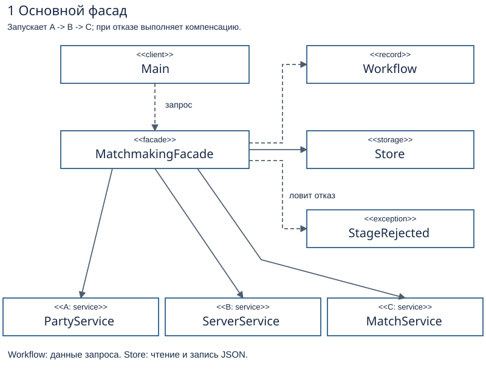
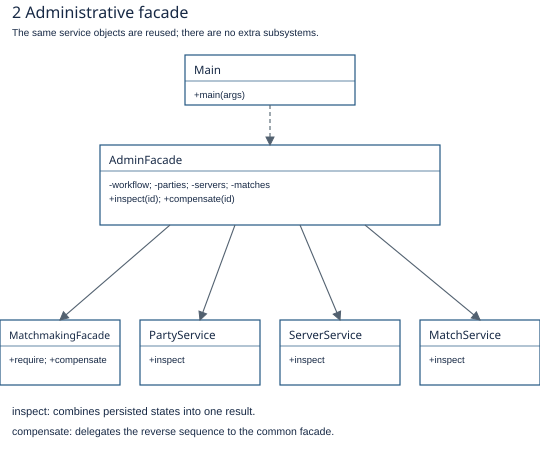
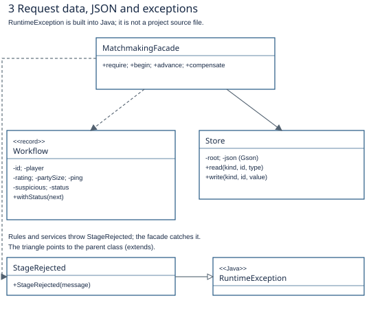
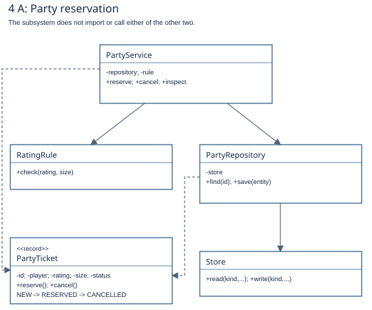
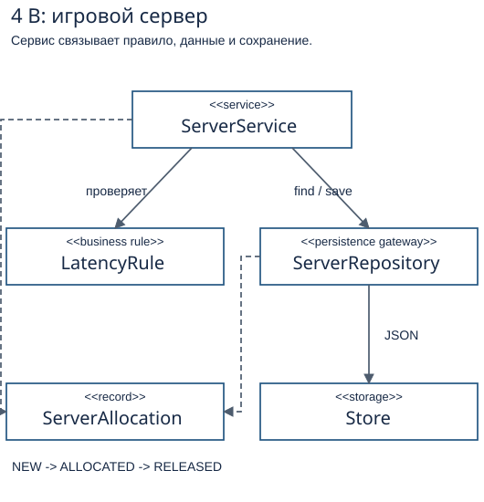
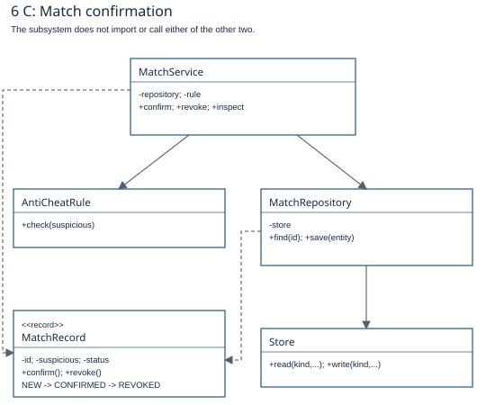

# Подготовка к защите Facade

[PDF](../output/pdf/Facade_Defense_Guide_RU.pdf) · [Полная UML](class-diagram.svg)

## Подготовка к защите Facade

### Assignment 4 · вариант 16 · Video Game Matchmaking

Этот материал объясняет структуру текущего проекта, связи классов и то, что нужно показать на защите. Построчного разбора кода здесь нет. Основа: исходники версии d9ca534 и требования из Assignment_4_Facade patterm (1).docx. Дата подготовки: 13 октября 2026.

Главная идея: один запрос на матч проходит три самостоятельные подсистемы: A резервирует группу, B выделяет сервер, C проверяет античит и сохраняет подтверждение матча. Фасад задаёт порядок и отменяет сохранённые действия при отказе.

| Этап | Что делает | Что сохраняет |
| --- | --- | --- |
| A | Проверяет имя, рейтинг и размер группы; резервирует группу | PartyTicket: RESERVED |
| B | Проверяет ping; создаёт выделение сервера | ServerAllocation: ALLOCATED |
| C | Проверяет suspicious; подтверждает и записывает матч | MatchRecord: CONFIRMED |

### Что нужно уметь объяснить

1. Почему это Facade и зачем два фасада.2. Кто хранит данные, кто проверяет правила, кто сохраняет JSON.3. Почему при отказе B отменяется только A, а при отказе C - B, затем A.4. Как программа восстанавливается после перезапуска.5. Как тесты подтверждают результат и независимость подсистем.

### Что действительно реализовано

Это работающая консольная модель с настоящим JSON-хранением. Она не ищет живых игроков, не запускает сетевой игровой сервер и не сканирует компьютер на читы. Рейтинг, ping и suspicious вводятся пользователем; правила принимают решение по этим значениям. Подтверждение C - сохранённая запись сессии, а не отдельный журнал событий.

Сначала выучи страницы 2-7, затем пройди сценарии на странице 11 и ответь на вопросы страницы 13. Защита и live coding дают 50% оценки; понимание последовательности важнее запоминания строк.

## Клиент и основной фасад

Main - клиент: создаёт зависимости, читает ввод и показывает результат. Все сервисы создаются один раз; в фасады передаются ссылки на эти же объекты.

MatchmakingFacade хранит ссылки на три сервиса и Store. Только он знает общий порядок, глубину отмены и правила восстановления цепочки. Workflow - возвращаемые данные запроса; Store - сохранение прогресса.

| Метод фасада | Роль |
| --- | --- |
| begin | Создать ID и запрос; выполнить A. После успеха следующий этап - B. |
| advance | Прочитать прогресс и выполнить один следующий этап либо продолжить отмену. |
| run | Выполнить begin и два advance как одну полную операцию. |
| compensate | Отменить реально выполненные шаги в обратном порядке. |
| require | Загрузить запрос по ID; сообщить, если он не найден. |

В меню полный запуск реализован через begin и два advance, чтобы ID был показан до возможного отказа. Решения о B, C и отмене остаются в фасаде.

## Административный фасад

AdminFacade - второй, более узкий фасад. Он обязателен по пункту 3.2: нужен отдельный вход для inspection / manual compensation.

| Операция | Что происходит |
| --- | --- |
| inspect(id) | Вызывает require у основного фасада и inspect у трёх сервисов. Возвращает состояние цепочки и каждой подсистемы. |
| compensate(id) | Передаёт отмену основному фасаду. Сам не дублирует последовательность C -> B -> A. |

### Как читать стрелки

Сплошная стрелка - объект хранит ссылку на другой объект. Пунктирная - использует, создаёт или возвращает его. Пустой треугольник - наследование, направлен к родителю. + означает public, - означает private. На схемах показаны рабочие связи; создание зависимостей в Main не размножено стрелками.

Одинаковое имя на разных схемах означает тот же класс. Это не дополнительные копии подсистем. UML описывает структуру; порядок вызовов A -> B -> C нужно объяснять отдельно.

## Данные, хранение и отказ

| Класс | За что отвечает |
| --- | --- |
| Workflow | Один запрос в памяти: ID, игрок, рейтинг, размер группы, ping, suspicious и статус всей цепочки. record не меняется; withStatus создаёт копию. |
| Store | Читает и записывает JSON. Gson преобразует объект и текст. Сам не решает, какой шаг выполнять. |
| StageRejected | Тип ожидаемого бизнес-отказа. Правила или сервисы выбрасывают его; фасад ловит отказ B/C и запускает компенсацию. |

Объект в RAM не является базой данных. JSON - сохранённая запись на диске. Фасад загружает Workflow через Store и сохраняет новый статус через Store. Отдельного репозитория прогресса в текущей версии нет.

## Подсистема A и роли её классов

| Класс | Ответственность |
| --- | --- |
| PartyService | Резервирует и отменяет группу. Проверяет имя и отсутствие дубликата; вызывает правило, переход состояния и сохранение. |
| RatingRule | Разрешает рейтинг 0-3000 и размер группы 1-5. |
| PartyTicket | Данные группы; сам разрешает только NEW -> RESERVED -> CANCELLED. |
| PartyRepository | Собственный gateway A: find/save напрямую вызывают Store для папки party. |

Обычная операция: сервис вызывает правило, создаёт объект, вызывает его переход и сохраняет через репозиторий. При отмене сервис загружает объект, вызывает обратный переход и сохраняет новый статус.

## Подсистема B и роли её классов

| Класс | Ответственность |
| --- | --- |
| ServerService | Выделяет и освобождает сервер. Проверяет дубликат и сохраняет состояние. |
| LatencyRule | Разрешает ping 0-120 мс. Отрицательный ping и значение выше 120 отклоняются. |
| ServerAllocation | Данные выделения сервера; переходы NEW -> ALLOCATED -> RELEASED. |
| ServerRepository | Собственный gateway B: find/save напрямую вызывают Store для папки server. |

Обычная операция: сервис вызывает правило, создаёт объект, вызывает его переход и сохраняет через репозиторий. При отмене сервис загружает объект, вызывает обратный переход и сохраняет новый статус.

## Подсистема C и роли её классов

| Класс | Ответственность |
| --- | --- |
| MatchService | Подтверждает матч и отзывает подтверждение. Сохраняет запись результата C. |
| AntiCheatRule | Отклоняет suspicious=true. Это учебный флаг, не настоящий сканер читов. |
| MatchRecord | Данные матча; переходы NEW -> CONFIRMED -> REVOKED. |
| MatchRepository | Собственный gateway C: find/save напрямую вызывают Store для папки match. |

Обычная операция: сервис вызывает правило, создаёт объект, вызывает его переход и сохраняет через репозиторий. При отмене сервис загружает объект, вызывает обратный переход и сохраняет новый статус.

## Как проходит запрос и откат

### Пример успешного запроса: Anuar, рейтинг 1500, группа 2, ping 50, suspicious=no.

| Шаг | Кто выполняет | Сохранённый результат |
| --- | --- | --- |
| 1 | Main -> MatchmakingFacade.begin -> PartyService | A=RESERVED, flow=PENDING_B |
| 2 | Main -> advance -> ServerService | B=ALLOCATED, flow=PENDING_C |
| 3 | Main -> advance -> MatchService | C=CONFIRMED, flow=COMPLETED |

### Два обязательных уровня компенсации

B отказал: при ping 121 правило B выбрасывает StageRejected. A уже сохранена, B ещё не создана. Фасад пишет COMPENSATING, читает реальные сущности, отменяет A и пишет COMPENSATED.

C отказал: при ping 50 и suspicious=yes A и B уже сохранены. Античит отвергает C до создания MatchRecord. Фасад освобождает B, затем отменяет A. Отзывать C не требуется: её записи нет.

| Сценарий | Flow | A | B | C |
| --- | --- | --- | --- | --- |
| Успех | COMPLETED | RESERVED | ALLOCATED | CONFIRMED |
| Отказ B | COMPENSATED | CANCELLED | NONE | NONE |
| Отказ C | COMPENSATED | CANCELLED | RELEASED | NONE |
| Ручная отмена успеха | COMPENSATED | CANCELLED | RELEASED | REVOKED |

NONE означает отсутствие файла сущности; это не четвёртое значение enum. Компенсация меняет статусы, а не стирает файлы. Ручная отмена завершённого матча выполняет C -> B -> A.

При неверном рейтинге, размере группы или пустом имени A отклоняется до сохранения группы. Для неверного рейтинга Workflow уже записан и помечается COMPENSATED; это не означает, что партия была создана.

## JSON и восстановление цепочки

| Папка | Данные | Кто сохраняет |
| --- | --- | --- |
| data/workflow | Входные данные и этап всей цепочки | MatchmakingFacade -> Store |
| data/party | Группа и её статус | PartyRepository -> Store |
| data/server | Выделение сервера и его статус | ServerRepository -> Store |
| data/match | Подтверждение матча и его статус | MatchRepository -> Store |

Во всех четырёх записях используется один ID. Каждый файл называется &lt;id&gt;.json. Store пишет UTF-8 во временный файл, затем атомарно заменяет запись. Это защищает от наполовину записанного основного файла; это не общая транзакция четырёх файлов и не гарантия от любого сбоя питания.

| Статус цепочки | Что означает |
| --- | --- |
| PENDING_B | Нужно выполнить B; фактическое наличие A дополнительно проверяется. |
| PENDING_C | Нужно выполнить C; наличие уже записанной C тоже проверяется. |
| COMPLETED | Цепочка закончена; повторный advance ничего не запускает. |
| COMPENSATING | Отмена начата; advance продолжает её. |
| COMPENSATED | Отмена закончена; повторная отмена ничего не делает. |

### Что происходит при перезапуске

Программа создаёт новые Java-объекты и читает те же JSON-файлы. Если B записалась, но маркер ещё PENDING_B, проверка наличия B не позволяет создать её повторно. Аналогично для C. Если программа остановилась при отмене, уже отменённые сущности пропускаются.

Тонкость: begin сохраняет PENDING_B до резервирования A. Если остановка случилась между этими действиями, advance проверяет наличие A и создаёт её. Поэтому решения нельзя принимать только по одному маркеру прогресса.

Повреждённый или пустой JSON вызывает явную ошибку. Программа не принимает такой файл за отсутствующую запись. Схема рассчитана на один процесс на папку данных; одновременная запись из нескольких процессов не реализована.

## Требования и критерии оценки

| Пункт | Что требуется | Что показать в проекте |
| --- | --- | --- |
| 3.1 | 3-5 классов в каждой из A/B/C; правило, сущность, gateway; 3 статуса; независимость | По 4 класса в каждом пакете. Переходы защищены сущностями; direct-use test вызывает все сервисы без фасада. |
| 3.2 | Не меньше двух фасадов; реальная логика последовательности | MatchmakingFacade: advance/compensate. AdminFacade: inspect/manual compensation. |
| 3.3 | Состояние и прогресс переживают перезапуск | JSON четырёх видов; реальный перезапуск между A и B. |
| 3.4 | Отказ B: отменить A. Отказ C: отменить B, затем A | Ping 121 и suspicious=yes; открыть сохранённое состояние после отказа. |
| 3.5 | Least Knowledge: конкретные before/after в README | Клиент знает один фасад вместо координации трёх сервисов. |
| 3.6 | Дополнительный реальный отказ; свои исключения | Неверный рейтинг/размер/имя; StageRejected. |
| 3.7 | F.I.R.S.T., DSL, оба отката, reload, >=80% line coverage | 17 тестов, gameAt(disk), TempDir, JaCoCo; свежий отчёт. |
| 3.8 | Работающая CLI/API с вводом, просмотром, обоими отказами | Четыре пункта меню; демонстрация через ввод, не только тесты. |
| 3.9 | Класс-диаграмма совпадает с конечным кодом | Новая SVG из шести связанных панелей; всего 18 основных классов. |
| 3.10 | Facade vs Adapter: не больше половины страницы | Краткое объяснение намерения в README. |

### Распределение оценки

50% - устная защита и live coding; 25% - тесты; 10% - живое приложение; 10% - документация; 5% - подсистемы, фасады и сохранение.

До сдачи: отправить ссылку на репозиторий в Moodle в срок преподавателя. Индивидуальность домена, запрет повторения старых заданий и сходства с чужой работой проверяются отдельно; тесты этого не доказывают.

## Сценарий живой демонстрации

Запуск: из папки проекта выполнить .\run.cmd. Нужны Java 17+ и Maven 3.9+. Для отдельной чистой папки после сборки можно запустить JAR с аргументом demo-data.

| Сценарий | Ввод после пункта 1 | Что доказать |
| --- | --- | --- |
| Успех | Anuar; 1500; 2; 50; no; yes | Request completed; A reserved; B allocated; C confirmed. |
| Отказ B | Anuar; 1500; 2; 121; no; yes | A cancelled; B/C not created. |
| Отказ C | Anuar; 1500; 2; 50; yes; yes | B released; A cancelled; C not created. |
| Первый шаг отказал | Anuar; -1; 2; 50; no; yes | Ошибка рейтинга; сущности A/B/C не созданы. |

В каждом вводе последние два ответа - Suspicious player? и Run all steps now?. Скопируй ID, показанный до шагов B/C. Пункт 3 показывает результат по ID; никаких автоподстановок ID нет.

### Показать перезапуск

1. Пункт 1: Anuar; 1500; 2; 50; no; no.2. Скопировать ID; убедиться, что A reserved и запрос ждёт B.3. Выйти через 0 и заново запустить программу с той же папкой данных.4. Пункт 3, вставить ID: увидеть прежние состояния.5. Пункт 2, тот же ID: выполнить B; пункт 3: проверить результат.6. Пункт 2, тот же ID: выполнить C; увидеть завершение.

### Показать ручную компенсацию

После успешного матча выбрать 4 и ввести ID. Получатся C revoked, B released, A cancelled. Повторить 4 с тем же ID: результат остаётся тем же. Это работа второго фасада.

### Сброс перед новой демонстрацией

Закрыть приложение. Удалить только папку данных этого демо или выбрать новую папку аргументом JAR. Не удалять src, docs или .git. JSON-файлы открываются обычным редактором; ID связывает записи между папками.

## Тесты и доказательства

Команда проверки: mvn verify. Запускает JUnit и проверяет минимальное покрытие JaCoCo 80%. На этом Windows-профиле есть обход кириллицы через subst; точные команды находятся в README.

| Набор | Тестов | Что подтверждает |
| --- | --- | --- |
| MatchmakingTest | 11 | Успех, оба отката, повторное открытие хранилища, старый маркер, ручная/прерванная отмена, правила переходов, самостоятельность сервисов. |
| MainTest | 3 | Настоящий консольный ввод, оба отказа по введённым значениям, продолжение сохранённого запроса в новом запуске меню. |
| StoreTest | 3 | JSON и Unicode, числа/boolean, замена записи, отсутствие временных файлов, явная ошибка повреждённого JSON. |

### F.I.R.S.T. на твоём проекте

| Буква | Смысл | Конкретное подтверждение |
| --- | --- | --- |
| F - Fast | Быстрые | Локальные небольшие файлы; нет сети и игровых серверов. |
| I - Independent | Независимые | Своя TempDir у каждого теста; общий порядок не требуется. |
| R - Repeatable | Повторяемые | Известный ввод; чистая папка; явный ping и suspicious. |
| S - Self-validating | Проверяют себя | Assertions сравнивают сохранённые состояния и ожидаемые исключения. |
| T - Timely | Вместе с реализацией | История Git показывает тесты вместе с изменениями исходников. |

DSL: gameAt(disk) - собственный доменный помощник для настройки тестового окружения. Самостоятельность A/B/C демонстрирует eachSubsystemWorksDirectlyAndEnforcesTransitions. Reload демонстрирует restartMidChainUsesSavedProgress.

В проверенной версии: 17 тестов проходят; 178 из 178 строк измеряемого production-кода покрыты (100%). Main исключён из отчёта покрытия, но отдельно проверяется MainTest. 100% line coverage не означает 100% branch coverage и не гарантирует отсутствие всех ошибок.

## Ответы для устной защиты

Что такое Facade?Простой вход к совместной работе нескольких независимых подсистем. Здесь он координирует запуск матча и отмену.

Где интерфейс фасада?У нас конкретные классы фасадов. Java interface не обязателен; их public-методы образуют доступный клиенту интерфейс.

Почему два фасада?Обычный сценарий и административные операции имеют разный набор задач. Второй фасад прямо требуется пунктом 3.2.

Почему это не Adapter?Мы организуем порядок нескольких совместимых операций. Adapter переводит несовместимый интерфейс в ожидаемый.

Кто выполняет бизнес-проверки?RatingRule, LatencyRule и AntiCheatRule. Фасад координирует результаты, а не дублирует эти проверки.

Что такое compensation?Новое обратное действие над уже сохранённой записью. Это не откат одной SQL-транзакции и не удаление файлов.

Почему при C сначала отменяется B?Шаги выполнены A -> B; отмена идёт в обратном порядке B -> A. C не сохранена, если античит её отклонил.

Зачем Workflow, если есть JSON?JSON хранит запись на диске; Workflow представляет один запрос в оперативной памяти для работы фасада.

Почему оставлены репозитории подсистем?Каждая подсистема обязана иметь свой persistence gateway, который обращается к хранилищу напрямую.

Что означает Least Knowledge?Клиент вызывает фасад, а не управляет сервисами, правилами и репозиториями всех подсистем.

Что защищает допустимые переходы?Методы сущностей. Повторный или неверный переход вызывает IllegalStateException независимо от фасада.

Какие ограничения честно назвать?Один процесс на папку данных; внешние серверы и античит моделируются вводом. Атомарна отдельная запись, не вся цепочка.

## Подготовка утром и live coding

### План на 45-60 минут

1. 10 минут: пройти UML и назвать роль всех 18 основных классов.2. 10 минут: объяснить A -> B -> C и два обратных сценария без подсказки.3. 15 минут: руками показать успех, оба отказа и перезапуск.4. 10 минут: повторить Facade/Adapter, Least Knowledge, F.I.R.S.T. и способы доказательства.5. 10 минут: отработать небольшое изменение правила и проверку результата.

### Как действовать при неожиданном задании

Сначала определить, к какой подсистеме относится изменение. Изменение предела ping относится к LatencyRule; новое условие античита - к AntiCheatRule; новое правило порядка или отмены - к MatchmakingFacade. Для нового входного параметра отдельно проверить Main, Workflow, сохранение и тесты.

После изменения показать две вещи: правильный отказ и правильное состояние на диске после компенсации. Например, если новый порог ping равен 80, проверить 80 как допустимое значение и 81 как отказ B. Примеры на этой странице - упражнения, а не уже добавленные функции.

### Короткая речь на английском

My project uses two facades over three independent subsystems. The common facade reserves a party, allocates a server, and confirms the match after an anti-cheat check. Each subsystem has its own entity, rule, service, and persistence gateway. State and workflow progress are stored in JSON. If server allocation fails, the party reservation is cancelled. If anti-cheat rejects the player, the server is released first, then the party is cancelled. The admin facade provides inspection and manual compensation. Restart recovery uses the saved workflow and entity states.

### Перед защитой

Уметь запустить проект одной командой; скопировать ID; открыть JSON; вызвать B- и C-отказ; перезапустить посреди цепочки; показать тест самостоятельных подсистем и JaCoCo; объяснить стрелки UML. Отправить ссылку в Moodle самостоятельно до дедлайна преподавателя.

### Источники

1. Assignment_4_Facade patterm (1).docx: пункты 3.1-3.10, разделы 4-6, вариант 16.2. Репозиторий https://github.com/Anuarrich0/Facade: версия исходников d9ca534.3. docs/coverage.csv и JUnit-наборы в src/test/java/matchmaking.
